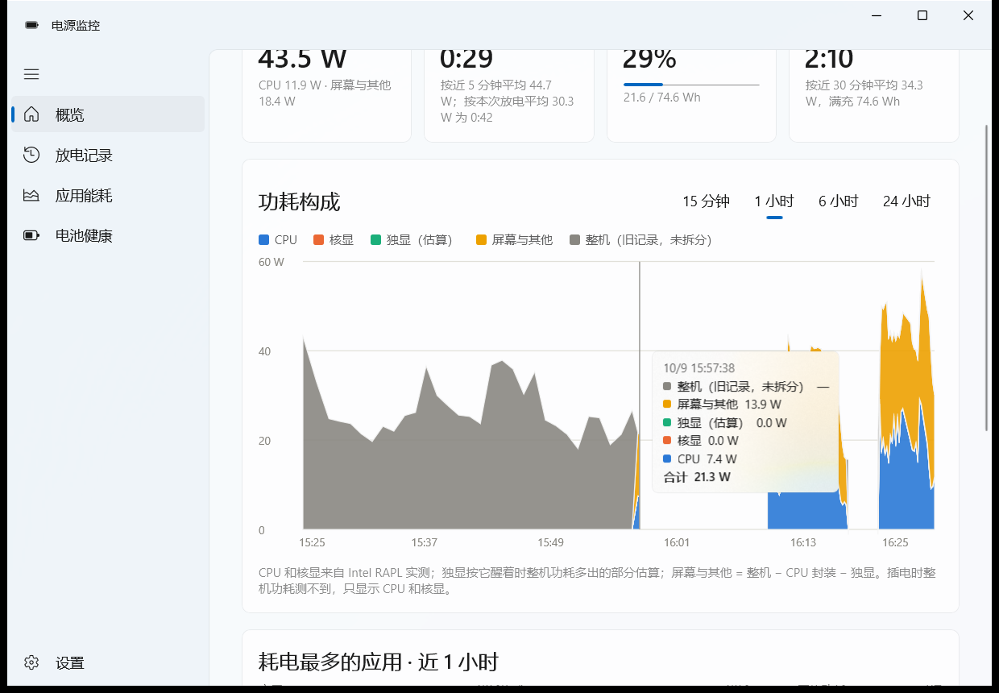
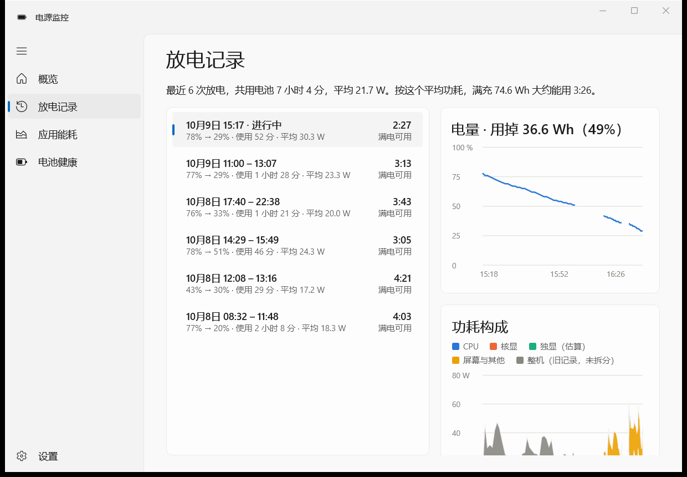
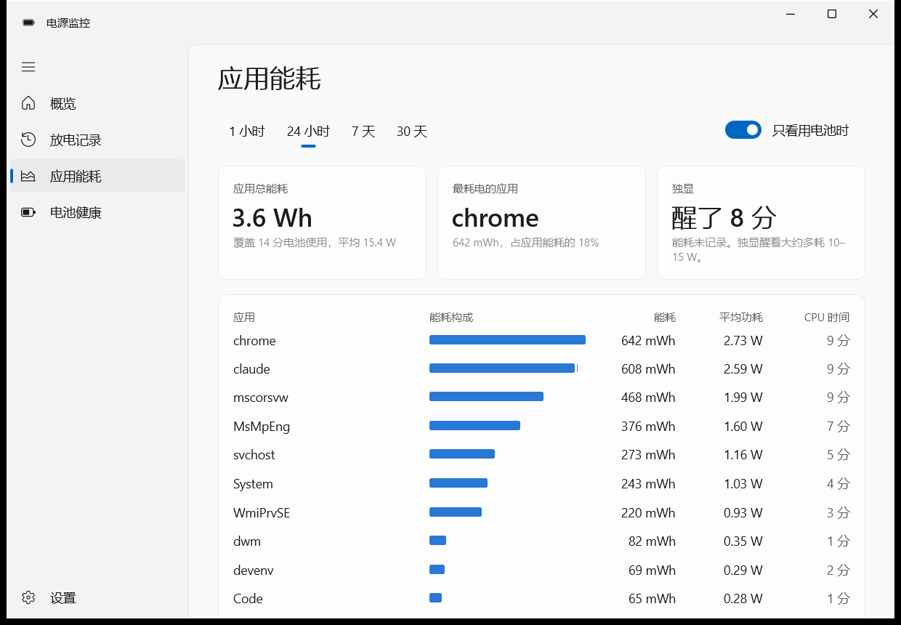
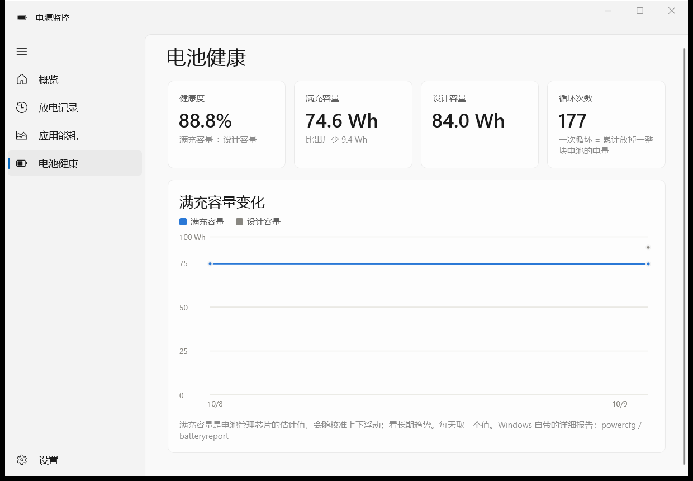
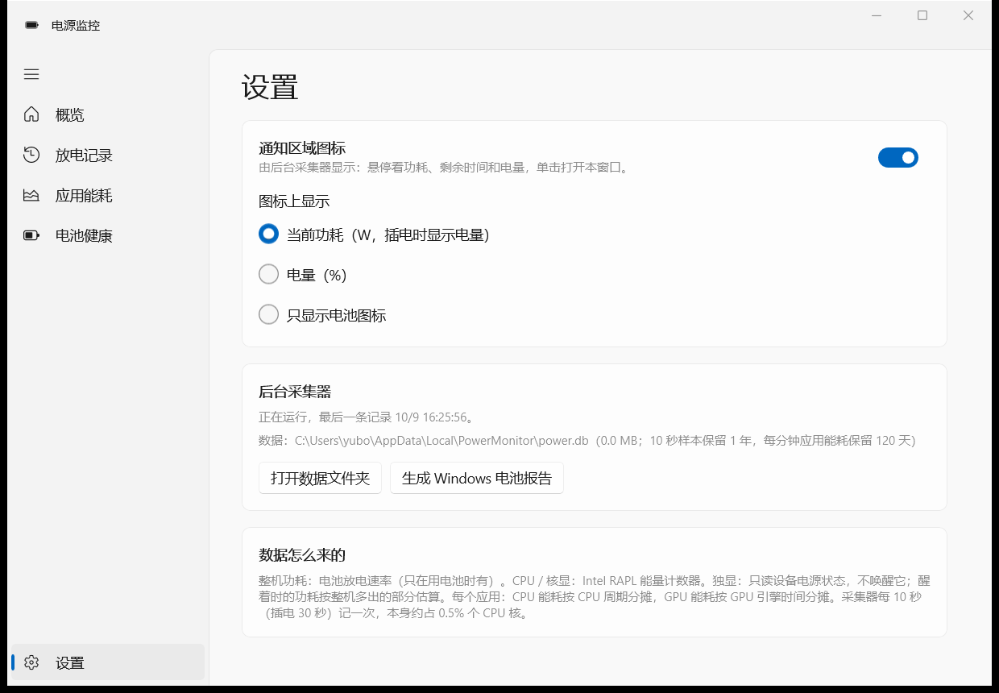

# Power Monitor · 电源监控

A small Windows 11 app for laptops that answers two questions:
**how long does a charge actually last**, and **which apps are using the battery**.
A light background collector samples power every 10 seconds; a WinUI 3 app shows
the history, and a tray icon shows the live draw.

The UI is in Simplified Chinese.



| Discharge sessions | Per-app energy |
| --- | --- |
|  |  |
| **Battery health** | **Settings** |
|  |  |

Tray icon with the live draw in watts (hover for time left and charge):


## What it shows

- **概览 Overview**: current draw, time left (last 5 minutes and this discharge), charge,
  and the runtime of a full charge at your recent average. The stacked chart splits
  the draw into CPU, iGPU, dGPU and the rest of the platform (display, memory, SSD, Wi-Fi...),
  with the apps that used the most energy below it.
- **放电记录 Sessions**: every discharge from unplug to plug-in, with the charge used,
  the time in use, the average draw, and what a full charge would last at that rate.
- **应用能耗 Apps**: energy per app over 1 h / 24 h / 7 d / 30 d, split into CPU, iGPU and dGPU.
- **电池健康 Health**: full-charge vs design capacity, cycle count, capacity over time.
- **Tray**: live watts (or charge %) drawn into the icon; click to open the app.

## How it measures

| Quantity | Source |
| --- | --- |
| Whole-laptop draw | Battery discharge rate (`IOCTL_BATTERY_QUERY_STATUS`); only known on battery |
| CPU package, cores, iGPU | Intel RAPL through the Windows `Energy Meter` performance counters |
| dGPU | Its PnP device power state (D0/D3) only. While awake, its draw is estimated as the platform power above its level while the dGPU sleeps |
| Per-process CPU | CPU cycles per process from one `NtQuerySystemInformation` snapshot |
| Per-process GPU | `GPU Engine` running time per process and adapter |

Per-app energy: CPU energy (package minus iGPU) is split by CPU cycles, iGPU energy
by GPU engine time on the iGPU, the dGPU estimate by engine time on the dGPU.
Display and the rest of the platform are not attributed to apps. Treat app numbers
as a good ranking, not a meter reading.

Design rules the collector keeps:

- **Never wake the dGPU.** It reads the device power state and never touches NVML /
  `nvidia-smi`, which would bring a sleeping dGPU to D0 and cost 10-15 W.
- **No WMI in the sampling loop.** A WMI query per sample costs more CPU (in
  `WmiPrvSE`) than everything else; battery, RAPL, processes and GPU all use native APIs.
- **Cheap**: about 0.5-0.7 % of one core and ~55 MB, every 10 s on battery and 30 s on AC.

## Requirements

- Windows 11 x64, a laptop battery.
- CPU and iGPU numbers need the `Energy Meter` counters (Intel RAPL; check with
  `Get-Counter -ListSet 'Energy Meter'`). Without them the app still shows battery
  draw, sessions, health and per-app CPU time.
- Building: .NET 10 SDK (`winget install Microsoft.DotNet.SDK.10`) or Visual Studio 2026
  with the WinUI workload.

## Install

```powershell
git clone https://github.com/Yubo-Cao/power-monitor
cd power-monitor
.\install.ps1          # build, install to %LOCALAPPDATA%\Programs\PowerMonitor, start the collector
.\uninstall.ps1        # remove (keeps data; -RemoveData deletes it too)
```

No admin rights needed. The installer publishes the app and collector into one
self-contained folder, registers the per-user scheduled task **Power Monitor Collector**
(at logon, plus a watchdog), and adds **电源监控** to the Start menu. Windows 11 puts new
tray icons in the overflow (^) menu; drag it onto the taskbar to keep it visible.

Data stays on the machine: `%LOCALAPPDATA%\PowerMonitor\power.db` (SQLite). 10-second
samples are kept for a year, per-minute app energy for 120 days.

## Layout

```
src/PowerMonitor.Core       readers (battery, RAPL/PDH, processes, GPU), sampler, SQLite store, settings
src/PowerMonitor.Collector  background sampler + tray icon (WinForms NotifyIcon, no windows)
src/PowerMonitor.App        WinUI 3 app, unpackaged; charts are drawn with XAML shapes
```

`PowerMonitorCollector.exe --probe 3` prints three samples as JSON without touching the store.
`POWERMONITOR_DB=<path>` points both programs at another database for testing.

## License

MIT
